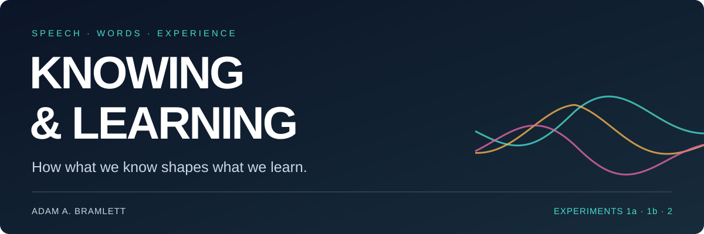
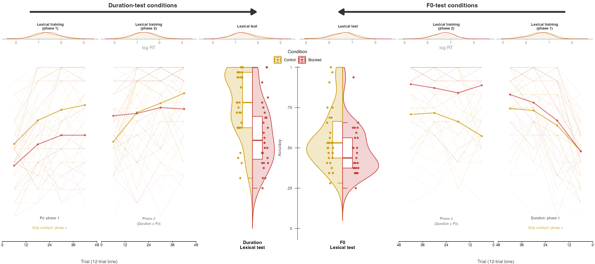
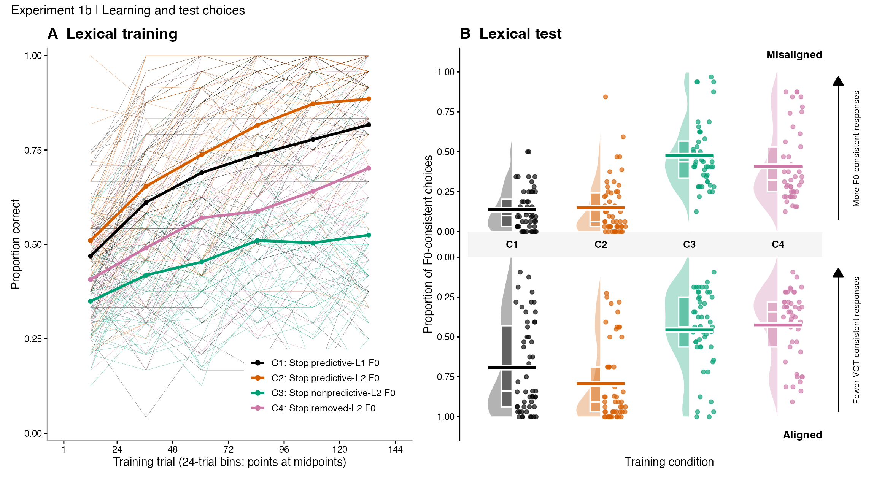
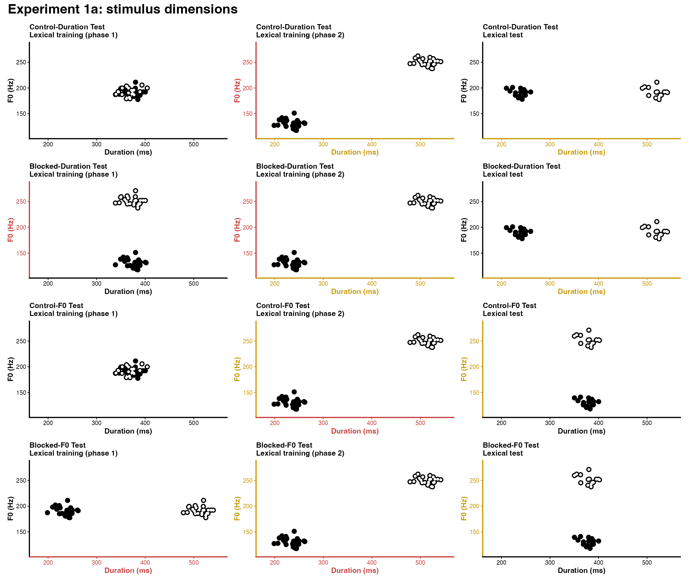
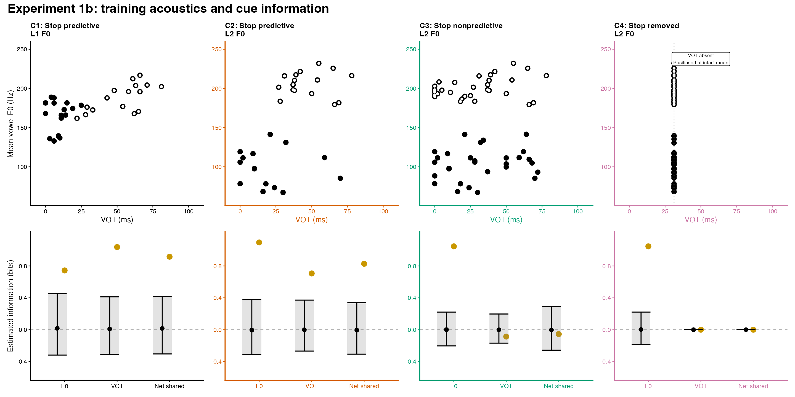
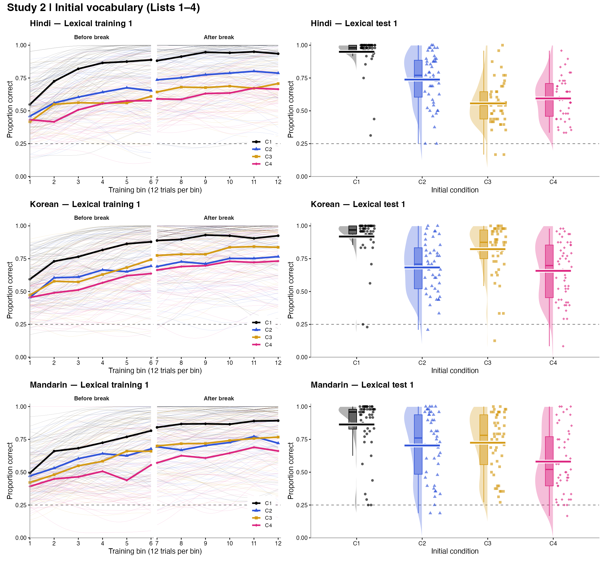
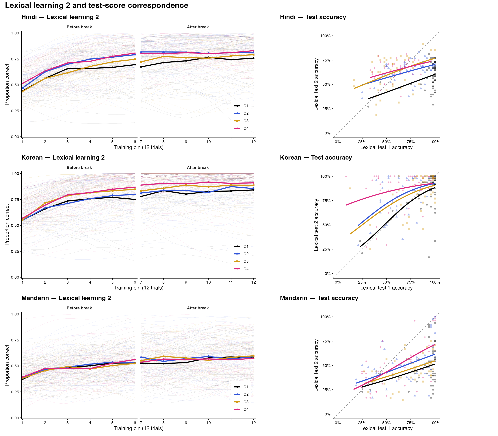
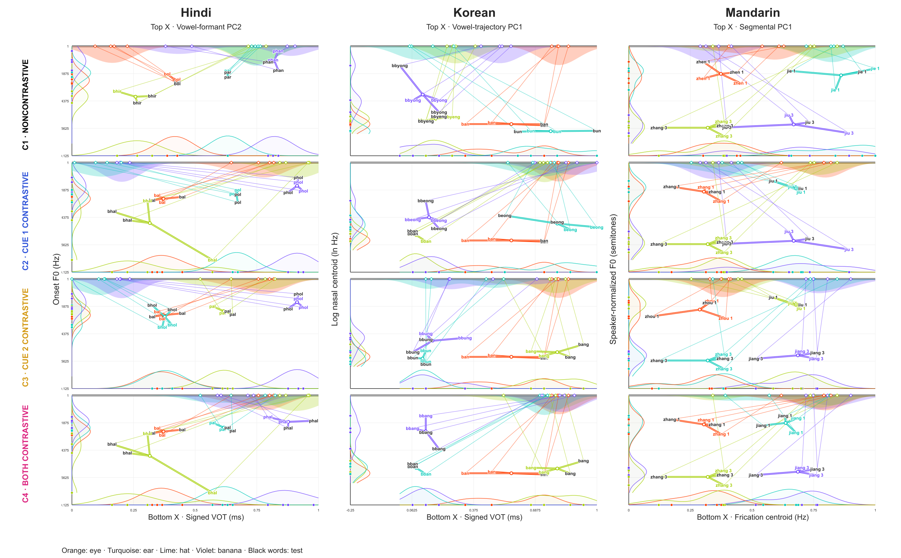
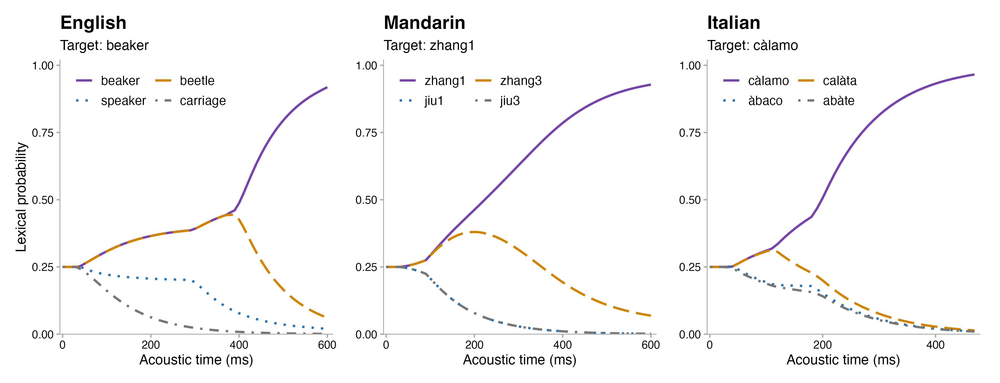

  

  <b><a href="Experiment_1a.Rmd">Experiment 1a</a> &nbsp; / &nbsp; <a href="Experiment_1b.Rmd">Experiment 1b</a> &nbsp; / &nbsp; <a href="Experiment_2.Rmd">Experiment 2</a></b>

## When does knowing more help us learn—and when does it hold us back?

Speech carries many sources of information. Which ones we learn to use depends on what we already know and what the words we are learning require us to distinguish.

These experiments test both sides of that relationship: **prior knowledge can constrain new learning, and lexical experience can prepare us for learning that comes next.** This repository contains the statistical analyses for Chapters 2 and 3 of Adam A. Bramlett’s dissertation at Carnegie Mellon University.

---

## 01 / When knowing more means learning less

**Chapter 2 · Experiments 1a and 1b**

Experiment 1a tests whether learning one cue first limits subsequent learning about another. Experiment 1b tests how the predictive value of familiar stop information shapes the use of lexical tone.

*Experiment 1a: learning and test performance after different learning histories. Control is gold; blocked is red.*

*Experiment 1b: learning trajectories and test choices. Each thin training line and test point represents a participant.*

**[Experiment 1a analysis →](Experiment_1a.Rmd) &nbsp; · &nbsp; [Experiment 1b analysis →](Experiment_1b.Rmd)**

<b>Explore the stimuli: Experiments 1a and 1b</b>

*Experiment 1a: how pitch and duration distinguish the words across learning phases and tests.*

*Experiment 1b: voice onset time, pitch, and the information available from each cue across the four conditions.*

## 02 / When knowing more means learning more

**Chapter 3 · Experiment 2 · Hindi, Korean, and Mandarin**

Does learning a vocabulary that requires more speech distinctions prepare listeners for a new vocabulary? Experiment 2 follows initial word learning with a shared new lexicon, connecting learning history, sound discrimination, and subsequent cue use.

*Experiment 2: initial vocabulary learning and test performance across the four lexical conditions in each language.*

<b>Explore the learning trajectories across all three languages</b>

 

*Subsequent lexical learning and test-score correspondence. Colors indicate the four initial lexical conditions.*

**[Experiment 2 analysis →](Experiment_2.Rmd)**

**[Explore the stimuli in Shiny →](https://adam-a-bramlett.shinyapps.io/stimuli_exploration/)**

<b>See the stimulus contrasts across languages</b>

*The words and acoustic contrasts in the four initial lexicons. Colors identify the pictured referents.*

---

## 03 / Words compete as speech unfolds

**Chapter 4 · General Model of Adaptive Speech Learning**

How do acoustic expectations guide recognition from moment to moment? These simulations follow competing words as the input unfolds in English, Mandarin, and Italian.

*Model simulations: normalized support for four lexical candidates, averaged over 20 repetitions per target. These are model predictions, not human behavioral curves.*

**[Model synthesizer →](https://github.com/AdamAnderB/study-token-synthesizer)**

---

## Preregistration and data

[View the preregistration on OSF →](https://doi.org/10.17605/OSF.IO/ZWKFT)

OSF is [phasing out its Projects storage and collaboration service](https://www.cos.io/osf-changes); preregistrations will remain available. In light of this transition, the study data are not currently shared. They will be made available once an alternative repository has been selected, with the link added here.

## Hear the acoustic forms

**[Model synthesizer →](https://github.com/AdamAnderB/study-token-synthesizer)**

[The Python synthesizer](https://github.com/AdamAnderB/study-token-synthesizer/blob/main/sound_synthesis.py) generates basic speech approximations from sampled acoustic trajectories. It requires Python with `numpy` and `praat-parselmouth`.

## Run the analyses

| File | Experiment |
| :--- | :--- |
| [Experiment_1a.Rmd](Experiment_1a.Rmd) | Temporal blocking |
| [Experiment_1b.Rmd](Experiment_1b.Rmd) | Structural blocking and lexical tone use |
| [Experiment_2.Rmd](Experiment_2.Rmd) | Initial lexical structure and subsequent learning |

Open the Rmd in RStudio and set `ADAPT_PROJECT_DIR` to the project directory containing `data`. Required R packages: `dplyr`, `tidyr`, `readr`, `ggplot2`, `lme4`, `emmeans`, `knitr`, `rmarkdown`, and `digest`.

Data are not bundled here. The scripts expect the original export folders. Experiment 1b also requires `data/exp_1b/analysis/rq3_training_information_k2_snapshot.csv`; Experiment 2 requires `data/exp_2.5/task_map.csv`. Experiment 2 retains the original `exp_2.5` data-folder name.

Adam A. Bramlett · Carnegie Mellon University

